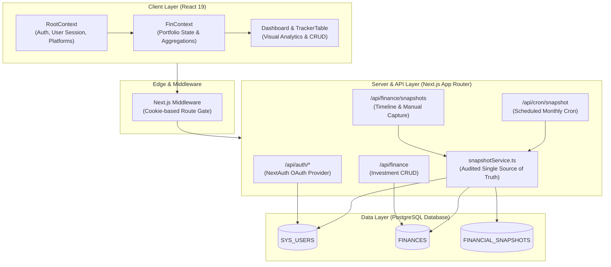
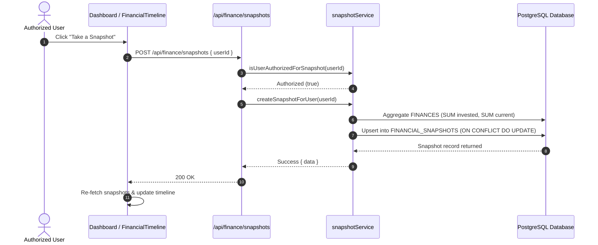

# Technical Architecture & System Design

This document details the architectural design, database schemas, data flows, and subsystem integrations of **FINTRAKR**.

---

## 1. High-Level Architecture

FINTRAKR is a full-stack Next.js application utilizing the App Router architecture. It pairs a relational PostgreSQL database with a reactive, client-side state hierarchy and automated background task infrastructure.

---

## 2. Component Roles & Architectural Boundaries

| Subsystem | Architectural Role & Boundaries |
|---|---|
| **Next.js App Router & Handlers** | Serves client components, exposes RESTful route handlers (`/api/*`), and handles edge session gating. |
| **Relational Data Layer (`pg`)** | Parameterized SQL execution via shared connection pool; handles multi-tenant data isolation and audit triggers. |
| **Authentication Subsystem** | NextAuth OAuth 2.0 integration; separates edge cookie gatekeeping from server session verification. |
| **Single Source Snapshot Engine** | Centralized business service (`snapshotService.ts`) shared identically across API routes, automated cron schedulers, and CLI tools. |
| **Reactive Client State Tree** | Tiered contexts (`RootContext` → `FinContext`) delivering memoized derived metrics and non-reactive styling caches. |
| **Vector Charting Engine** | Recharts SVG layer configured with zero-interval overrides (`interval={0}`) for responsive timeline plotting. |

> ℹ️ *For dependency versions, developer workflows, and local setup scripts, refer to the [Project README](../README.md).*

---

## 3. Database Schema

The database relies on three core relational tables managed by idempotent DDL migrations in [`src/app/api/migration.ts`](../src/app/api/migration.ts):

### A. `SYS_USERS`
Stores authenticated user identities provisioned automatically during initial OAuth registration.

| Column | Type | Constraints | Description |
|---|---|---|---|
| `id` | `SERIAL` | `PRIMARY KEY` | Unique internal user identifier |
| `email` | `VARCHAR(255)` | `UNIQUE NOT NULL` | Verified OAuth email address |
| `name` | `TEXT` | `NOT NULL` | User display name |

### B. `FINANCES`
Stores the active, current state of all user investments across platforms and owners.

| Column | Type | Constraints | Description |
|---|---|---|---|
| `id` | `SERIAL` | `PRIMARY KEY` | Unique investment record ID |
| `platform` | `VARCHAR(255)` | `NOT NULL` | Investment broker or financial platform |
| `platform_type` | `VARCHAR(255)` | `NOT NULL` | Asset type (e.g., Equity, Mutual Funds, Fixed Deposit) |
| `platform_category` | `VARCHAR(255)` | `NOT NULL` | Investment sub-category (e.g., Stocks, Debt, Gold) |
| `amount_invested` | `NUMERIC` | `NOT NULL` | Total principal capital invested |
| `amount_current` | `NUMERIC` | `NOT NULL` | Current market valuation |
| `updated_date` | `TIMESTAMPTZ` | `DEFAULT CURRENT_TIMESTAMP` | Last updated timestamp managed via DB trigger |
| `owner` | `VARCHAR(255)` | `NOT NULL` | Asset holder identifier (e.g., Primary, Partner, Joint) |
| `user_id` | `INTEGER` | `FK → SYS_USERS(id) ON DELETE CASCADE` | Scoped owner account ID |

> **Automated Audit Trigger:** A PostgreSQL `BEFORE UPDATE` trigger automatically updates `updated_date = CURRENT_TIMESTAMP` on every row modification, eliminating client clock skew.

### C. `FINANCIAL_SNAPSHOTS`
Persists point-in-time portfolio closures to power long-term growth visualizations and historical comparisons.

| Column | Type | Constraints | Description |
|---|---|---|---|
| `id` | `SERIAL` | `PRIMARY KEY` | Snapshot record ID |
| `user_id` | `INTEGER` | `FK → SYS_USERS(id) ON DELETE CASCADE` | Scoped user account |
| `snapshot_date` | `DATE` | `NOT NULL` | Normalized closure date (1st of month: `YYYY-MM-01`) |
| `total_invested` | `NUMERIC` | `NOT NULL` | Aggregated invested capital at snapshot date |
| `total_current` | `NUMERIC` | `NOT NULL` | Aggregated market valuation at snapshot date |
| `total_platforms` | `INTEGER` | `NOT NULL` | Count of distinct investment platforms active |
| `total_owners` | `INTEGER` | `NOT NULL` | Count of distinct portfolio owners represented |
| `created_at` | `TIMESTAMPTZ` | `DEFAULT CURRENT_TIMESTAMP` | Audit creation timestamp |

> **Idempotency Guarantee:** A composite unique constraint `UNIQUE (user_id, snapshot_date)` coupled with `INSERT ... ON CONFLICT (user_id, snapshot_date) DO UPDATE SET` ensures that retries or multiple manual captures in the same month safely update the existing record rather than generating duplicates.

---

## 4. Subsystem Architectures

### A. State Management & Data Flow
Application state is organized into a hierarchical context chain:

1. **`RootContext`:**
   - Initializes user authentication state from NextAuth.
   - Provisions user records on first login via `POST /api/profile`.
   - Exposes global UI states (loading spinner, notification toasts, responsive screen flags).
2. **`FinContext`:**
   - Depends explicitly on `RootContext` for `userId`.
   - Fetches and aggregates active investments (`/api/finance`) into summary KPIs (`totalInvested`, `totalCurrent`, `totalAbsReturn`).
   - Caches owner color distributions in `useRef<Map<string, string>>` to maintain visual continuity across re-renders without triggering unnecessary updates.
   - Manages historical snapshot state (`/api/finance/snapshots`) and exposes the `canTriggerSnapshot` permission boolean.

### B. Single Source of Truth Snapshot Engine
All snapshot generation logic is centralized in [`src/services/snapshotService.ts`](../src/services/snapshotService.ts) to guarantee zero logic drift across multiple operational interfaces:

- **Automated Monthly Cron (`/api/cron/snapshot`):** Executes on the 1st of every month via automated scheduler. Authenticated with `Bearer <CRON_SECRET>`. Iterates active users and commits closures. *(Configured via `CRON_SECRET`, see [Environment Variables](../README.md#environment-variables) and [Deployment](../README.md#deployment) in README).*
- **On-Demand Dashboard Trigger (`/api/finance/snapshots`):** Allows authorized users to capture point-in-time updates directly from the UI.
- **Administrative CLI Backfill:** Scripts invoke the service layer to seed historical data or run batch audits.

### C. Role-Based Access Control (RBAC) & Security
- **Zero Client Leakage:** Authorized user IDs and emails are configured purely via server environment variables (`AUTHORIZED_SNAPSHOT_USER_IDS`, `AUTHORIZED_SNAPSHOT_EMAILS`). If unset, access is strictly restricted by default (`[]`). *(See [Environment Variables](../README.md#environment-variables) in README).*
- **Capability Flags:** The client interface never receives the list of authorized admin IDs or emails. Instead, `GET /api/finance/snapshots` evaluates authorization on the server and returns `{ canTriggerSnapshot: boolean }`.
- **Edge Route Protection:** Next.js middleware guards protected routes at the network edge, verifying the presence of session cookies before delegating to serverless execution.

### D. Data Visualization & Responsive Charting
- **Recharts Integration:** Historical net worth and invested capital are rendered via SVG `<AreaChart>` with custom linear gradients.
- **Tick Collision Prevention:** Recharts defaults to `interval="preserveEnd"`, which aggressively drops intermediate ticks on mobile viewports. Explicitly configuring `interval={0}` on `<XAxis>` forces rendering of all 12 monthly data points.
- **Scalable Temporal Navigation:** A custom dropdown `<select>` element (`timeline-year-select`) supports any number of historical years without overflowing horizontal card headers, unlike rigid tab arrays.
- **Macro Annual View:** The "All (Annual)" filter aggregates monthly closures to plot year-over-year trajectory across macro periods.

---

## 5. Architectural Principles

1. **Authoritative Consistency over Optimistic UI:** Financial transactions and snapshots avoid optimistic mutations; all writes perform server mutations followed by authoritative re-fetching.
2. **Multi-Tenant User Isolation:** Every query against `FINANCES` and `FINANCIAL_SNAPSHOTS` is parameterized and scoped by `user_id`.
3. **Defense-in-Depth:** Validation occurs at multiple layers: client UI validation, edge middleware checks, server-side route guardrails, and database relational constraints.
4. **DRY Business Logic:** Core mathematical aggregations and database mutations are encapsulated in shared services rather than duplicated across Next.js route handlers.
