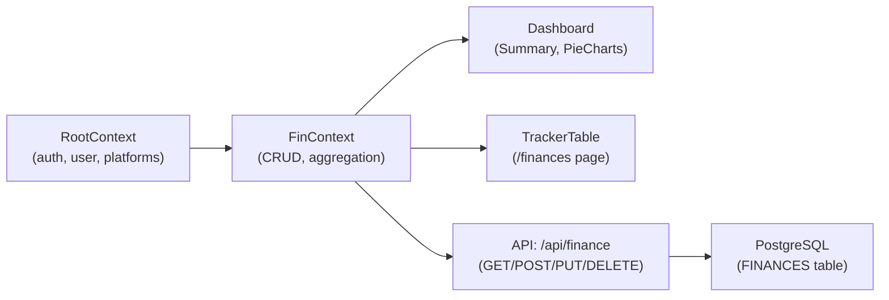

# Phase 1: Codebase Exploration & Understanding

## Tech Stack

| Layer | Technology |
|---|---|
| **Framework** | Next.js 16.3.5 (App Router, Turbopack) |
| **Language** | TypeScript 5.6.3 |
| **Styling** | Tailwind CSS 4.3.3 + CSS Modules |
| **Database** | PostgreSQL (Neon serverless) via raw `pg` Pool — **no ORM** |
| **Auth** | NextAuth v4 (Google OAuth) |
| **Charting** | **Recharts 3.10.1** (currently: `PieChart`, `ResponsiveContainer`, custom `Tooltip`) |
| **UI Extras** | react-toastify, react-icons, react-responsive, clsx |
| **Testing** | Vitest + Testing Library + jsdom |
| **Font** | Inter (Google Fonts) |
| **Deployment** | Vercel (inferred from Neon + Cloudflare analytics) |

## Database Schema (2 Tables)

### `SYS_USERS`
| Column | Type |
|---|---|
| `id` | SERIAL PK |
| `email` | VARCHAR(255) UNIQUE NOT NULL |
| `name` | TEXT NOT NULL |

### `FINANCES`
| Column | Type |
|---|---|
| `id` | SERIAL PK |
| `platform` | VARCHAR(255) |
| `platform_type` | VARCHAR(255) |
| `platform_category` | VARCHAR(255) |
| `amount_invested` | NUMERIC |
| `amount_current` | NUMERIC |
| `updated_date` | TIMESTAMPTZ (auto-updated via trigger) |
| `owner` | VARCHAR(255) |
| `user_id` | INTEGER FK → SYS_USERS(id) ON DELETE CASCADE |

> [!NOTE]
> Migrations are run at server startup via [`migration.ts`](file:///e:/work/remote/fin-tracker/src/app/api/migration.ts) using `CREATE TABLE IF NOT EXISTS`. There is no ORM or migration tool — just raw SQL in the `pg` pool.

## How Financial Data Flows

1. **[`RootContext`](file:///e:/work/remote/fin-tracker/src/context/RootContext.tsx)** — Handles auth session, user registration (`POST /api/profile`), platform configs, popup state, loader, responsive queries.
2. **[`FinContext`](file:///e:/work/remote/fin-tracker/src/context/FinContext.tsx)** — On login, fetches all finance records for the user (`GET /api/finance?userId=`), derives `memberWiseData`, `financeSummaryData` (totals, returns, owner/platform counts). Exposes `addFinance`, `updateFinance`, `deleteFinance`.
3. **Dashboard** — Renders:
   - [`Summary`](file:///e:/work/remote/fin-tracker/src/components/Dashboard/Summary/Summary.tsx): aggregated KPIs (total invested, current, return, return %)
   - [`OwnerDistribution`](file:///e:/work/remote/fin-tracker/src/components/Dashboard/OwnerDistribution/OwnerDistribution.tsx): Recharts PieChart by owner
   - [`CategoryDistribution`](file:///e:/work/remote/fin-tracker/src/components/Dashboard/CategoryDistribution/CategoryDistribution.tsx): Recharts PieChart by category
   - Both use the reusable [`DistributionChartTable`](file:///e:/work/remote/fin-tracker/src/components/Dashboard/DistributionChartTable/DistributionChartTable.tsx) component (pie + data table side-by-side)

## Key Patterns & Observations

- **No background job / cron mechanism exists.** No scheduler library, no cron routes, no Vercel cron config.
- **Database interactions** are direct raw SQL via `pg` `Pool` — all in [`/api/finance/route.ts`](file:///e:/work/remote/fin-tracker/src/app/api/finance/route.ts).
- **Table constants** (`SYS_USERS_TABLE`, `FINANCES_TABLE`) are centralized in [`constants.ts`](file:///e:/work/remote/fin-tracker/src/utils/constants.ts).
- **Recharts** is already installed and used for Pie charts; it also supports `LineChart`, `AreaChart`, `BarChart` — all available for the timeline visualization without adding new dependencies.
- **Reusable UI patterns**: `DashboardCard` wrapper, `DistributionChartTable`, `CustomTooltip`, `CustomLabel`.
- The app is **multi-user** — each user's finance data is scoped by `user_id`.
- **No snapshot or historical data** is currently persisted. The `FINANCES` table only stores the *current* state of each investment.
